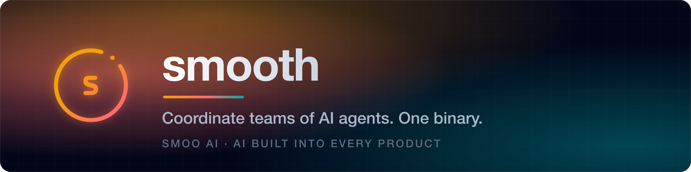
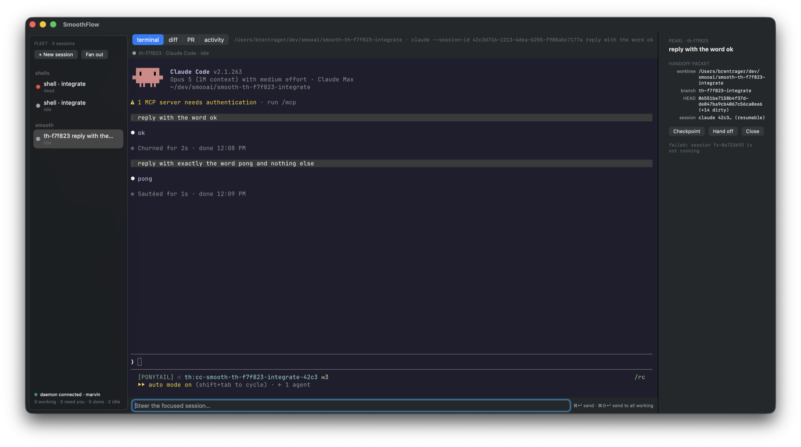

<p align="center">
  <a href="https://smoo.ai"></a>
</p>

<p align="center">
  <a href="docs/bench-history.md"></a>
  <a href="docs/Model-Leaderboard.md"></a>
  <a href="https://smoo.ai"></a>
  <a href="LICENSE"></a>
</p>

<p align="center">
  <a href="https://www.rust-lang.org/"></a>
  <a href="https://github.com/SmooAI/smooth/releases"></a>
</p>

<p align="center">
  <a href="#install"><b>Install</b></a> &nbsp;·&nbsp; <a href="#choose-your-model"><b>Choose your model</b></a> &nbsp;·&nbsp; <a href="#what-you-get-today"><b>What you get</b></a> &nbsp;·&nbsp; <a href="#coming-soon"><b>Coming soon</b></a> &nbsp;·&nbsp; <a href="#architecture"><b>Architecture</b></a> &nbsp;·&nbsp; <a href="#the-th-cli"><b>CLI</b></a>
</p>

---

> **Your always-on AI assistant, and the CLI that runs your coding agents.** Big Smooth lives on your machine, remembers what matters, and works with your calendar, reminders and messages. `th` gives Claude Code, Codex and OpenCode shared work tracking, agent-to-agent mail, clean handoffs and a context budget. One Rust binary, no runtime dependencies.

---

## Install

```bash
brew install SmooAI/tools/th      # macOS (Apple Silicon) and Linux
th --version
```

That uses the [SmooAI/homebrew-tools](https://github.com/SmooAI/homebrew-tools) tap; `brew upgrade th` picks up new releases. No Homebrew? `curl -fsSL https://raw.githubusercontent.com/SmooAI/smooth/main/install.sh | sh`. Windows: use WSL for now. Then follow the [Quickstart](docs/Start-Here/Quickstart.md).

### Set up with your coding agent

Paste this into Claude Code, Codex or OpenCode and it does the whole setup for you: install, wire up every harness, verify, choose a model.

```text
Install or update th (Smooth, by Smoo AI) to the latest release on this machine and wire it into Claude Code, OpenCode and Codex.

1. Run `brew update && (brew upgrade smooai/tools/th || brew install smooai/tools/th)`. Then run `th --version`. If an older th wins on PATH (check `which -a th`), fix PATH so the Homebrew copy wins.
2. Run `th harness enable claude-code`, `th harness enable opencode` and `th harness enable codex`. They are idempotent: each sets up the plugin, the MCP server, hooks and skills, and for Claude Code it also moves the statusline to the newest plugin.
3. Verify:
   - `th harness status` shows all three harnesses.
   - `th harness budget` prints: suggest /th-clear 150k · warn 270k · auto-compact 300k.
   - ~/.claude/settings.json has "autoCompactWindow": 300000, unless I set my own value.
   - ~/.codex/config.toml has model_auto_compact_token_limit = 300000.
   - If ~/.claude/settings.json has no statusLine entry, run `th doctor --setup-statusline`.
4. Choose a model: run `th model login`. Pick smooai-gateway for the Smoo AI Family plan, or enter my own OpenAI or Anthropic key.
5. Report what changed and anything that failed, with the exact errors. Then tell me to restart running sessions (or run /reload-plugins in Claude Code).
```

Setting up another machine? `th install-prompt --copy` puts this prompt on your clipboard. It lives in [docs/Start-Here/Install-Prompt.md](docs/Start-Here/Install-Prompt.md).

## Choose your model

|                  | **Family plan**                                                                         | **Bring your own key**                                                                          |
| ---------------- | --------------------------------------------------------------------------------------- | ----------------------------------------------------------------------------------------------- |
| What you get     | Hosted models through the [Smoo AI gateway](https://llm.smoo.ai). One key, every model. | Any OpenAI- or Anthropic-compatible endpoint you already pay for, or a local one (Ollama).      |
| Price            | $9/month, 14-day free trial                                                             | Whatever your provider charges                                                                  |
| Set up           | `th model login smooai-gateway`                                                         | `th model login anthropic` (or `openai`, `openrouter`, `google`, `ollama`, …)                   |
| Any other server |                                                                                         | `th providers add <id> --url <base-url> --api-key <key> --format openai\|anthropic --model <m>` |
| Learn more       | [smoo.ai/big-smooth#plan](https://smoo.ai/big-smooth#plan)                              | [Quickstart › Bring your own key](docs/Start-Here/Quickstart.md#bring-your-own-key)             |

`th model status` shows what's configured; `th routing` picks which model handles coding, reasoning, review and the rest.

## What you get today

### Big Smooth, your always-on assistant

```bash
th up                              # start it; chat at http://localhost:4400, or `th code` in the terminal
```

- **Memory.** It remembers what you tell it and recalls it later. Signed in (`smoo auth login`), memory syncs across your devices.
- **Your Mac.** Calendar, Reminders, Messages, Contacts and Location, each behind a one-time macOS grant (`th doctor --setup-calendar`, `--setup-reminders`, `--setup-imessage`).
- **The web.** Web search and page reading for anything current.
- **Notifications.** It pushes to your devices when a reminder comes due or a long job finishes.
- **Schedules.** Prompts it runs on a cadence: `th daemon schedule add`.
- **Your browser.** `th chrome install` adds bookmarks (synced ones too) and opt-in tab control. See [Chrome Extension](docs/Engineering/Chrome-Extension.md).

**On a Mac, there's a desktop app (beta):** [download Big Smooth for Mac](https://downloads.smoo.ai/bigsmooth/latest-arm64.dmg) (Apple Silicon). Or keep the daemon running across reboots with `th service install`. How it works: [What Is Smooth](docs/Start-Here/What-Is-Smooth.md).

### The harness toolbox for Claude Code, Codex, OpenCode and Cursor

```bash
th harness enable all              # idempotent: also the update command
```

- **Pearls**: a work tracker every session shares, with Jira sync (`th pearls ready`, `th jira sync`).
- **Agent mail**: sessions message each other and hand off work (`th agent`, `th msg`).
- **`/th-handoff` and `/th-clear`**: write a durable handoff into a pearl, clear the context, and resume in the same terminal.
- **The context budget.** Sessions auto-compact at 300k tokens instead of running to the model's limit. Past 150k the agent suggests `/th-clear` at natural milestones (a commit, a push, green tests), and the Claude Code statusline shows a context meter.

`th harness budget --report` measures what the budget is worth on your own transcripts. On ours (30 days, 124 Claude Code sessions), 78% of input tokens came from calls already past 300k. Resetting at the budget would have used up to about 58% fewer input tokens, and taking every `/th-clear` suggestion up to about 77% fewer. Both are upper bounds, because they ignore the re-reading a fresh session does.

Details: [Using the th CLI › th harness](docs/Engineering/Using-th-CLI.md#1b-th-harness--harness-manifests--per-provider-toolbox-setup).

### SmoothFlow: run a fleet of coding agents

```bash
th flow new --kind claude          # also codex, opencode, a shell, …
th flow ls
```

Claude Code, Codex and OpenCode sessions run under tmux inside Big Smooth, so they survive closing the terminal. The [SmoothFlow Mac app](https://downloads.smoo.ai/smoothflow/latest-arm64.dmg) shows the whole fleet, what needs you, and each session's pearl and handoff. Fan one prompt out to several agents and keep the winner with `th flow fanout`.

<p align="center"></p>

More: [SmoothFlow](docs/Architecture/SmoothFlow.md), [the Mac app](docs/Architecture/SmoothFlow-macOS.md).

### Local CI you can trust: `th attest` and `th ci-queue`

```bash
th attest --all                    # run scripts/ci/<check>.sh locally, push, credit each pass as a status
th ci-queue run --lock cargo -- cargo test
```

`th attest` runs your repo's CI checks on your machine and credits the passes on the PR. `th ci-queue` stops a dozen agents from running heavy builds at once.

### `th pkg`: one package, every harness

```bash
th pkg install <owner/repo>        # skills, rules, MCP servers and hooks into Claude Code, Codex and OpenCode
```

See [Harness Packages](docs/Engineering/Harness-Packages.md).

### The model leaderboard

Every model we route to is benchmarked by [`smooth-bench`](crates/smooth-bench) on 28 real agentic scenarios, with pass rate, cost per pass and a separate safety score. Slots default to whatever wins on cost per pass. See [the leaderboard](docs/Model-Leaderboard.md) ([JSON](docs/model-leaderboard.json)) and [The Line](docs/bench-history.md).

### `smoo`: the Smoo AI platform CLI

```bash
smoo auth login
smoo crm contacts list --json
```

The same binary is also `smoo`: CRM, config, agents, analytics and the rest of [Smoo AI](https://smoo.ai). Append `ai` to any command (`smoo org ai`) for a markdown guide.

## Coming soon

- **Big Smooth for iPhone and Android**
- **A browser extension** for chatting with Big Smooth from any page

The Mac desktop app is already available as a beta: [download it](https://downloads.smoo.ai/bigsmooth/latest-arm64.dmg). Join the waitlist for the rest at [smoo.ai/big-smooth#coming-soon](https://smoo.ai/big-smooth#coming-soon). What else is next: [Roadmap](docs/Start-Here/Roadmap.md).

---

## Architecture

`th up` starts **Big Smooth** (`smooth-daemon`) as a host process on `127.0.0.1:4400`. It hosts the [`smooth-operator`](https://github.com/SmooAI/smooth-operator) engine in-process: each message runs as an agent turn on the canonical WebSocket protocol, and events stream back to every client (the web chat, `th code`, SmoothFlow, the phone relay). There is no per-task worker process and no VM.

```
   th up                         th harness enable all
     │                                   │
     ▼                                   ▼
┌──────────────────────────────┐   ┌──────────────────────────────┐
│ Big Smooth  (127.0.0.1:4400) │   │ Claude Code · Codex ·        │
│ smooth-operator engine,      │◀──│ OpenCode · Cursor            │
│ in-process · tools · memory  │   │ + th MCP server, hooks,      │
│ permission gate → Narc       │   │   skills, context budget     │
└──────────────┬───────────────┘   └──────────────────────────────┘
               │
   web chat · th code · SmoothFlow app · phone (relay)
```

**Security layers**, in order: a permission gate with deny rules (installed first; irreversible tools ask), then **Narc** (secret, prompt-injection and dangerous-shell detectors, plus secret redaction), then an opt-in kernel sandbox for shell commands on macOS (`th settings set sandbox.enabled true`).

### Model routing

Every LLM call goes through a **routing slot**, and the slot resolves to a concrete model, so changing models doesn't change code:

| Slot               | Used by                                     |
| ------------------ | ------------------------------------------- |
| `smooth-coding`    | The coding loop (also the `smooth-default`) |
| `smooth-reasoning` | `th code` Plan/Think modes                  |
| `smooth-reviewing` | Review mode, code-review flows              |
| `smooth-judge`     | Narc's LLM judge, bench scoring             |
| `smooth-summarize` | Context compression in long runs            |
| `smooth-fast`      | Session names, short titles, autocomplete   |

The mapping lives in [`smooth_policy::smooth_alias`](crates/smooth-policy/src/smooth_alias.rs). Repoint a slot with `th routing` or `th code`'s model picker. The `th code` loop itself is [`smooth_cast::coding_workflow`](crates/smooth-cast/src/coding_workflow.rs).

Full detail lives in the docs vault ([docs/Home.md](docs/Home.md)):

- [`Architecture-Overview`](docs/Architecture/Architecture-Overview.md): top-level diagram and control flow
- [`Daemon-Modules-and-Security`](docs/Architecture/Daemon-Modules-and-Security.md): the daemon's modules and security layers
- [`The-Cast`](docs/Architecture/The-Cast.md): Big Smooth, Narc, Diver and the rest
- [`Dispatch`](docs/Architecture/Dispatch.md) and [`Operatives`](docs/Architecture/Operatives.md): how `th run` hands a pearl to an agent
- [`Security-Model`](docs/Architecture/Security-Model.md): the permission gate, Narc and the sandbox
- [`SmoothFlow`](docs/Architecture/SmoothFlow.md): the session engine
- [`Extension-System`](docs/Architecture/Extension-System.md): SEP, the extension protocol
- [`Daemon-Direction`](docs/Architecture/Daemon-Direction.md): where Big Smooth is headed

## The `th` CLI

`th --help` is a map; `th <command> --help` has the details, and `th <command…> ai` prints a markdown guide written for people and agents. The full reference is [docs/Engineering/Using-th-CLI.md](docs/Engineering/Using-th-CLI.md). The most-used commands:

```bash
th up / down / status            # Big Smooth
th code                          # the coding TUI (also bare `th`)
th model login | status          # LLM providers
th harness enable | status       # wire up Claude Code / Codex / OpenCode / Cursor
th install-prompt --copy         # the agent install prompt, on your clipboard
th pearls ready | create | close # work tracking
th agent / th msg                # agent mail
th flow ls | new | attach        # SmoothFlow sessions
th worktree create | merge       # git worktrees
th attest --all                  # local CI attestation
th doctor                        # health check, auto-fix, guided setup
th service install               # keep Big Smooth running across reboots
```

### Claude Code plugin (`smooth-agent`)

`th harness enable claude-code` installs it for you. To add it by hand:

```
/plugin marketplace add SmooAI/smooth
/plugin install smooth-agent@smooth
```

Or pin it per repo in `.claude/settings.json`:

```jsonc
{
    "extraKnownMarketplaces": {
        "smooth": { "source": { "source": "github", "repo": "SmooAI/smooth" } },
    },
    "enabledPlugins": { "smooth-agent@smooth": true },
}
```

It brings the `th-handoff`, `th-clear`, `pearls-flow`, `agent-comms`, `th-mail`, `smoothflow` and `smooth-operator` skills; session hooks that register every session on agent mail and run the context budget; and the shared SmooAI guardrails (worktree enforcement, `th`-over-`curl` nudges).

### Extending Smooth

- **MCP servers**: `th mcp add <name> <command…>` adds any [Model Context Protocol](https://modelcontextprotocol.io) server, globally or per project (`--project`). [`budget-aware-mcp`](https://github.com/Doorman11991/budget-aware-mcp) ships as a default (`th mcp defaults`). `th mcp serve` is the `th` MCP server itself.
- **CLI-wrapper plugins**: a TOML manifest at `.smooth/plugins/<name>/plugin.toml` becomes an agent tool (`th plugin init`).
- **Packages**: `th pkg install` (above).

See [`docs/extending.md`](docs/extending.md) and [`SECURITY.md`](SECURITY.md).

## Workspace

```
smooth/
├── crates/
│   ├── smooth-cli/          # Binary `th` (and `smoo`): the clap CLI
│   ├── smooth-daemon/       # Big Smooth, the always-on agent daemon
│   ├── smooth-tools/        # Agent tools + the opt-in kernel sandbox
│   ├── smooth-policy/       # Policy types, settings registry, routing slots
│   ├── smooth-goalie/       # HTTP forward proxy (egress boundary)
│   ├── smooth-pearls/       # SQLite pearl tracker, memories, agent mail
│   ├── smooth-cast/         # Coding-harness pieces: th code loop, skills
│   ├── smooth-code/         # `th code` ratatui TUI
│   ├── smooth-diver/        # Pearl lifecycle + Jira sync
│   ├── smooth-flow/         # SmoothFlow engine
│   ├── smooth-tmux/         # tmux driver
│   ├── smooth-api-client/   # Generated api.smoo.ai client
│   └── smooth-web/          # Embedded web SPA (React + Vite)
├── apps/smoothflow/         # SmoothFlow macOS app
├── claude-plugins/          # The smooth-agent plugin
└── install.sh               # curl installer
```

The agent engine `smooth-operator` lives in its own repo, [SmooAI/smooth-operator](https://github.com/SmooAI/smooth-operator). Per-crate detail: [Workspace-Crates](docs/Architecture/Workspace-Crates.md).

## Development

```bash
cargo build
cargo test
cargo fmt
cargo clippy                     # pedantic + nursery, zero warnings
pnpm install:th                  # build the web bundle and install th from source
pnpm format                      # oxfmt for everything that isn't Rust
```

Build details and the landing checklist: [Dev-Loop-and-Landing](docs/Engineering/Dev-Loop-and-Landing.md).

## 🧩 Part of Smoo AI

Smooth is built and open-sourced by **[Smoo AI](https://smoo.ai)**, the AI-powered business platform with AI built into every product: CRM, customer support, campaigns, field service, observability and developer tools.

- 🏠 **Big Smooth and the Family plan**: [smoo.ai/big-smooth](https://smoo.ai/big-smooth)
- 🚀 **Smooth on the platform**: [smoo.ai/th](https://smoo.ai/th)
- 🧰 **More open source from Smoo AI**: [smoo.ai/open-source](https://smoo.ai/open-source)
- 🧩 **Sibling packages**: [smooth-operator](https://github.com/SmooAI/smooth-operator) (the agent engine Smooth runs), [@smooai/deploy](https://github.com/SmooAI/deploy), [@smooai/logger](https://github.com/SmooAI/logger), [@smooai/config](https://github.com/SmooAI/config)

## 🤝 Contributing

Issues and PRs welcome. All feature work happens in a git worktree (`th worktree create`). See [CLAUDE.md](CLAUDE.md) for build, test and workflow conventions, and [SECURITY.md](SECURITY.md) for the security model.

## 📄 License

MIT © [Smoo AI](https://smoo.ai). See [LICENSE](LICENSE).

---

<p align="center">
  Built by <a href="https://smoo.ai"><strong>Smoo AI</strong></a> — AI built into every product.
</p>
